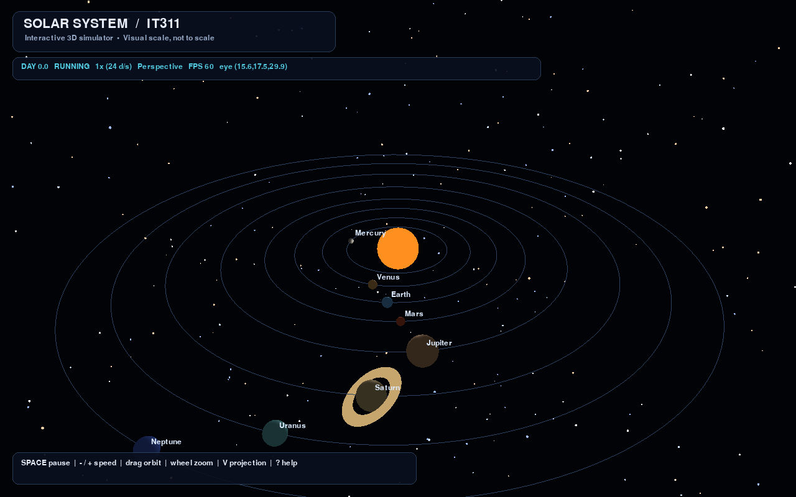

# Interactive 3D Solar System Simulator (IT311)

An educational real-time solar-system viewer built in Python 3, Pygame and OpenGL 3.3 Core. Geometry, transforms, camera matrices, shaders, lighting, interaction and animation are implemented in the project; this is not a pre-rendered background or an external 3D engine.

## Features

- The Sun, eight planets, an Earth-parented Moon, Saturn's child ring mesh, sampled elliptical orbit trails and 1,500 procedural point stars.
- Solar-wind particle system with position, velocity, lifetime, respawn, weak radial acceleration, semi-implicit Euler integration and varying color/size.
- Interactive orbit camera (drag and wheel), planet selection, focus, perspective/orthographic projection, Phong lighting, depth testing and face culling.
- Compact on-screen title and simulation status, selection highlight, body labels and FPS; there is no side control panel.

## Verified visual previews

These screenshots were captured from the running OpenGL renderer on Mesa llvmpipe:



## Requirements and start

Python 3.10+ and a graphics driver that exposes **OpenGL 3.3 Core Profile** are required. A discrete GPU is not required; a recent Mesa software renderer can be sufficient. The cloud build environment used for source validation may not provide a display server, so the interactive window must be launched on a desktop session.

```bash
cd solar_system
python -m venv .venv
# Linux/macOS
source .venv/bin/activate
# Windows PowerShell: .venv\Scripts\Activate.ps1
python -m pip install --upgrade pip
python -m pip install -r requirements.txt
python main.py
```

If the OpenGL window cannot be created, update the OS graphics driver and verify OpenGL 3.3 support (for example, `glxinfo | grep 'OpenGL core profile version'` on Linux). The program prints a direct error message when the context or shader compiler is unavailable. This project uses a 3.3-core shader pipeline; a legacy OpenGL fallback is not bundled.

## Controls

| Input | Action |
|---|---|
| `1`–`8` | Select Mercury through Neptune |
| Left / Right arrow | Previous / next planet |
| Mouse drag | Orbit camera around its target |
| Mouse wheel | Zoom in/out (bounded) |
| `F` | Focus selected body |
| `B` | Return to full-system view |
| `R` | Reset camera |
| `V` | Switch Perspective / Orthographic projection |
| `Space` | Pause / resume simulation |
| `-` / `+` | Change speed among 0.1×, 1×, 10×, 100× |
| `0` | Reset simulation day |
| `O` / `S` / `N` | Toggle orbits / stars / labels |
| `P` | Toggle solar-wind particles |
| `G` | Toggle diffuse/specular lighting (ambient remains in shader) |
| `?` | Show/hide help overlay |
| `Esc` | Quit |

Clicking a nearby projected body selects it; dragging the background orbits the camera. There is no Mission Control side panel.

## Architecture

- `main.py` — launcher.
- `src/app.py` — window, event loop, simulation state and input.
- `src/math3d.py` — explicitly implemented vectors, homogeneous matrices, view and projection matrices.
- `src/scene.py` — model transforms and Earth–Moon / Saturn–ring hierarchy.
- `src/mesh.py` — procedural UV sphere, ring triangles and orbit samples.
- `src/renderer.py` — VAO/VBO setup, GLSL compilation, Phong materials, depth/culling and HUD composite.
- `src/camera.py`, `animation.py`, `particles.py`, `ui.py`, `planet_data.py` — focused modules for their named concerns.
- `shaders/` — GLSL 3.3 Core shaders.
- `tests/test_core.py` — CPU-side math, data, scene and simulation tests.

## Graphics pipeline and mathematical model

For each vertex in homogeneous coordinates, the vertex shader evaluates

```text
clipPosition = Projection × View × Model × localPosition
```

OpenGL then performs clipping, perspective division to NDC, and viewport mapping. Matrices are represented as 4×4 NumPy arrays with column-vector semantics. `math3d.py` contains identity, translation, scaling, X/Y/Z rotations, multiplication, point/vector transforms, `look_at`, perspective and orthographic projections. The camera view basis is constructed from forward, right=`normalize(cross(forward, up))`, and corrected up vectors; no `gluLookAt` call hides the operation.

A planet's orbital angle is `theta(t) = theta0 + 2π t / T`, where `t` is simulation days and `T` the orbital period. Its local position is an ellipse sample (small eccentricity for visual interest). Rotation uses the supplied approximate spin period. `delta_time` advances the simulation clock, so animation is independent of rendering frame rate. A deliberately accelerated educational clock keeps distant orbital changes observable.

The Moon's world matrix is explicitly composed as `M_earth_world × M_moon_local`; the local matrix contains lunar orbit, local offset, spin and visual scale. Saturn's annular triangle mesh inherits its orbit translation and axial tilt.

The fragment shader uses ambient + Lambert diffuse + Blinn–Phong specular terms, with the Sun as a central point light. The Sun uses an emissive material. Depth testing is enabled; back-face culling is enabled for closed spheres (disabled for the two-sided ring mesh). The star field and planet meshes use static GPU buffers; transient solar-wind points are updated in a dynamic VBO.

## Visual scale and scientific values

Real astronomical radii and distances cannot be drawn legibly in a single ordinary window. The simulator therefore uses intentionally exaggerated visual radii and compressed orbital distances; the ratios are not a scientific distance scale. Orbital periods, spin periods and selected physical facts are rounded educational reference values, not a precision ephemeris. Temperatures refer to different conventions (surface mean for rocky worlds and approximate cloud-top values for giant planets), as indicated in the data. Moon counts are approximate and can change as discoveries are confirmed.


## Curriculum mapping

| Computer Graphics concept | Project location |
|---|---|
| Graphics pipeline / MVP | `renderer.py`, `planet.vert` |
| Homogeneous vectors & 4×4 transforms | `math3d.py` |
| Translation, rotation, scaling, composition | `math3d.py`, `scene.py` |
| Hierarchical modeling | Earth–Moon and Saturn–rings in `scene.py` |
| Camera/view transformation | `camera.py`, `math3d.look_at` |
| Perspective / orthographic projections | `math3d.py`, `camera.py` |
| Visibility, depth, back-face culling | `renderer.py` |
| Lighting and materials | `planet.frag`, `renderer.py` |
| Parametric curves | sampled orbit builder in `mesh.py` |
| Real-time animation / delta time | `animation.py`, `app.py` |
| Particle systems / integration | `particles.py` |
| Interaction / HUD | `app.py`, `ui.py` |

## Tests

```bash
python -m unittest discover -s tests -v
```

The tests validate matrix operations, camera direction, both projections, all eight records, hierarchical Moon composition, advancing orbital positions, pause/speed and reset behavior. A visual smoke test requires running `python main.py` in a graphical desktop with OpenGL 3.3: verify the window, spheres, camera drag/zoom, planet selection, pause/resume, orbit/star toggles and particle toggle.

## References

- NASA Solar System Exploration, Planets: <https://solarsystem.nasa.gov/planets/overview/>
- NASA/NSSDC, Planetary Fact Sheet: <https://nssdc.gsfc.nasa.gov/planetary/factsheet/>
- NASA Science, Solar System: <https://science.nasa.gov/solar-system/>

Planet data are rounded summaries based on these public reference pages; see `src/planet_data.py`.
